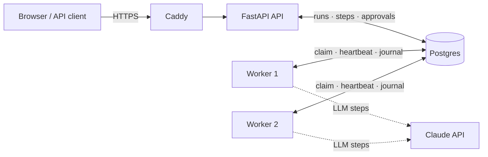
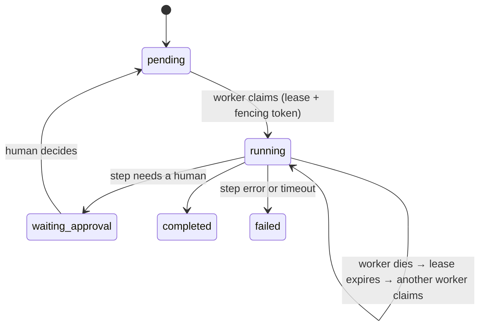

# Agent Runtime

**A Postgres-backed durable execution engine for AI agents and workflows.**
Kill a worker mid-task and another one resumes from the last saved step: finished work is never redone, and side effects like refunds happen effectively once, via idempotency keys.

**Live demo:** https://runtime.philx.dev (start runs, kill a worker, watch the run survive, and try the AI support agent)

<!-- Demo video: add a 30–60 s GIF or link here -->


---

## Why this exists

AI agents run long, multi-step tasks: call a model, call a tool, wait for a human, call another tool. If the process crashes halfway, a naive system either loses the work or **starts over**, re-running expensive LLM calls and repeating side effects (charging a card twice, sending two emails).

Agent Runtime makes every step **durable**:

| Guarantee | How |
|---|---|
| **Resume, don't redo** | Every finished step's result is saved in a journal. A new worker replays saved results instead of re-running them, including LLM calls, so the agent never pays twice or changes its mind. |
| **No duplicate side effects** | Each step gets a deterministic idempotency key (`run_id:seq`) that is passed to external services, so a retried step can't repeat a refund. |
| **Automatic failover** | Workers hold a time-limited lease with heartbeats. If a worker dies, its lease expires and another worker takes the run over. |
| **No zombie writes** | Each claim bumps a fencing token. A worker that was frozen and comes back can't write over the new owner's work. |
| **Human in the loop** | A step can pause the run until a person approves. The run parks without holding a worker and resumes when the decision arrives. |

## Results under chaos

A chaos script ran 4 worker processes against Postgres while randomly **SIGKILL-ing** workers and **freezing** them (SIGSTOP → SIGCONT after their lease expired, to create zombies):

| Metric | Result |
|---|---|
| Attacks | **1,000** (790 kills + 210 freezes) |
| Runs completed | **1,913 / 1,913** |
| Wrong outputs / wrong step counts | **0 / 0** |
| Duplicate refunds | **0** |
| Takeovers | 896 |
| Recovery time (2 s lease) | **p50 2.2 s · p95 3.1 s** |
| Throughput under attack (laptop) | 5.7 runs/s |

Full method and numbers: [`bench/RESULTS.md`](bench/RESULTS.md)

## Architecture



- **Postgres is the only coordinator.** There is no separate queue or supervisor: workers claim runs with `SELECT … FOR UPDATE SKIP LOCKED`, so two workers can never take the same run.
- **The API never runs workflows.** It writes requests into the database; workers pick them up.
- **Workers are stateless.** Everything needed to resume lives in the database.

### Life of a run



## Writing a workflow

```python
from agent_runtime.step import step
from agent_runtime.workflow import workflow
from agent_runtime.approval import require_approval
from agent_runtime import llm


@step(timeout=30)
async def classify(message):
    # An LLM call inside a step: the answer is journaled,
    # so a resumed run reuses it instead of calling Claude again.
    return await llm.ask(f"Classify as refund, bug, or question: {message}", max_tokens=5)


@workflow
async def support_agent(message, order_id):
    category = await classify(message)
    if category == "refund":
        if await require_approval(f"Refund $25 for order {order_id}?"):   # parks until a human decides
            await issue_refund(order_id)                                    # exactly once, via its idempotency key
    return await draft_reply(message, category)
```

Rules that make replay safe: anything non-deterministic (LLM calls, network, time, randomness) goes **inside** a `@step`, and steps run one at a time in a fixed order.

## API

| Method | Path | Notes |
|---|---|---|
| `POST` | `/runs` | Start a run. Admin key required. Optional `Idempotency-Key` header. |
| `GET` | `/runs`, `/runs/{id}` | A run with its journal (steps, attempts) and approvals. Public. |
| `POST` | `/runs/{id}/approvals/{seq}` | Approve or reject a parked step. Admin key required. |
| `GET` | `/demo/stats` | Live counters for the demo. |
| `POST` | `/demo/runs`, `/demo/kill`, `/demo/support` | Public demo actions, rate limited. |

Interactive docs: https://runtime.philx.dev/docs

## Tech stack

Python 3.13 · asyncio · Postgres 16 · psycopg 3 (async, connection pools) · FastAPI · Docker Compose · Caddy (automatic HTTPS) · AWS Lightsail · Supabase Postgres · GitHub Actions (CI/CD) · Anthropic Claude API · pytest

## Run it locally

```bash
docker compose up -d          # Postgres + API + worker (migrations run on API startup)
open http://localhost:8000
```

Run the tests (stop the local worker first, so it doesn't claim the tests' runs):

```bash
docker compose stop api worker
uv sync
uv run pytest -v
```

Run the chaos benchmark (local database only; it refuses anything else):

```bash
uv run python scripts/chaos.py            # full run
N_KILLS=50 uv run python scripts/chaos.py # quick run
```

The AI agent needs `ANTHROPIC_API_KEY` in the environment; tests use a fake model and never call the API.

## Deployment

Every merge to `main` runs the test suite on GitHub Actions against a throwaway Postgres; if it passes, the deploy job SSHes into the server, rebuilds the containers, and health-checks the live site. Only Caddy's ports 80/443 are public; the API port is never exposed.


## How I built this

I built this with Claude as a pair programmer. Claude proposed the architecture, explained the concepts, and wrote most of the backend code. I worked through every change myself: reading it, running it, testing it, and debugging failures until I understood why it works. The demo page frontend was generated entirely by Claude Code.

My own calls: the kill-switch design, staff-only refund approvals, and pushing the demo to prove resume (not just "no double refunds"). I set up and run the infrastructure: AWS Lightsail, DNS, Supabase, secrets, and CI/CD.

I can walk through any part of the backend in detail: the journal and replay, idempotency keys, leases and fencing, approvals, the chaos benchmark, and the deploy pipeline.


## What I'd do next

- **Workflow versioning:** changing a workflow's steps while runs are in flight breaks replay; tools like Temporal version workflows explicitly.
- **`LISTEN/NOTIFY` instead of polling** to pick up new runs instantly.
- **A stronger post-deploy smoke test** that starts a run and checks it completes, not just `/health`.
- **Blue-green deploys** so a bad release never takes traffic.
- **Scale limits:** a single Postgres is the coordinator; the next step would be partitioning runs across databases.
